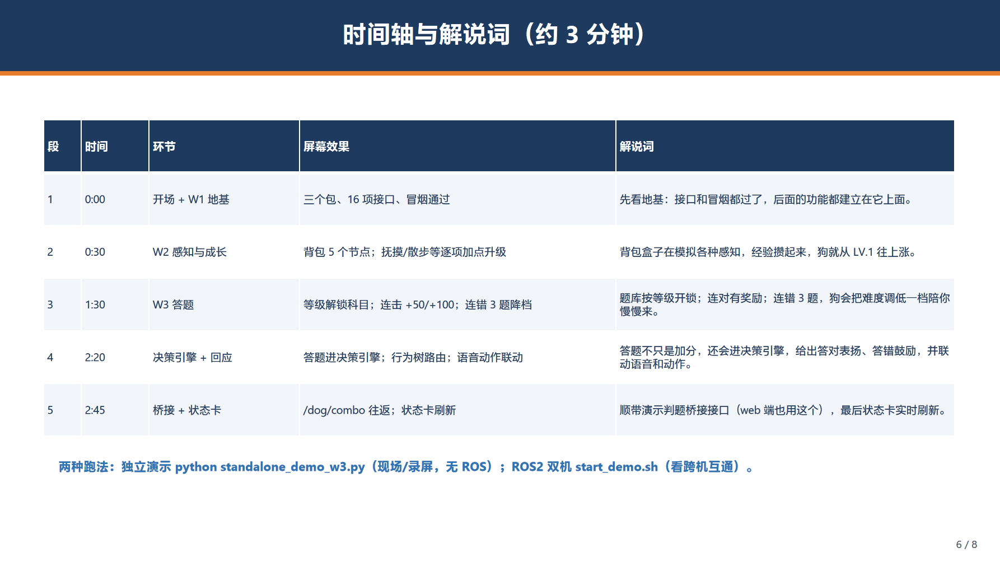

# 长夜月 · 养成系机械狗 W3 演示详解
## —— PPT 配套讲稿 + 项目思路 + 后续开发承接指南

> 配套：`演示_W3汇报.pptx`（8 页）· `docs/演示脚本_W3.md`（精简演示方案）
> 用途：一边翻 PPT 一边看这份文档补充信息；也是给组内/评委讲清"项目在做什么、走到哪、接下来怎么接着做"的完整底稿。
> 汇报人：李文扬（架构 / 集成）｜周期：W3（8.17–8.23）

---

## 〇、这份文档怎么用

- **第 1~8 节对应 PPT 8 页**：每节给出「屏幕上有什么」+「主讲要说的话（详版）」+「可以补充的细节 / 被追问时的回答」，比 PPT 上的字多得多，照着念不会超时也不会空场。
- **第九节往后是讲深了用的**：项目整体思路、关键设计、以及"之后开发怎么承接现在成果"的落地清单（W4~W7 及 9.18 之后）。
- 想快速了解"接下来怎么接着做"，直接看**第九节**。

---

# 第一部分 · PPT 逐页讲稿

## 第 1 页 封面

**屏幕上**：标题「W3 演示汇报：答题与基础闭环」、一句话链路「感知 → 加点 → 升级 → 答题 → 决策反应」、队名/人名/赛道。

**主讲**："大家好，我是长夜月团队的李文扬，负责整体架构和系统集成。这次汇报第三周的内容：答题和基础闭环。一句话概括——我们不依赖真实机器狗硬件，用 ROS2 仿真和模拟数据，把从感知到决策反应的整条软件流程跑通。"

**补充**：这是 7 周排期的第 3 周，最终目标（9.18 前）是用模拟数据跑通"感知 → 决策 → 成长"的完整软件闭环，等实体机器狗到位后直接迁移。

## 第 2 页 这次演示做什么

**屏幕上**：定位（无硬件、仿真+模拟数据跑通闭环）；思路（前两周打基础，第三周接上答题和决策）；三层（W1 接口契约 → W2 感知与成长 → W3 答题与决策）。

**主讲**："演示分三层，但其实是同一套代码逐步加长。第一周把接口协议定好，第二周把感知和成长做出来，第三周把答题和决策接上。所以第三周的内容不是另起炉灶，而是顺着前两周长出来的。"

**追问应答**：
- *为什么不用真实硬件？* 硬件排期未到，且我们要先验证"软件闭环"本身成立——用模拟数据把每一层接口、每一个规则都验到位，硬件一到就能平移。
- *模拟数据可信吗？* 所有业务规则（经验、周上限、连击、难度、等级解锁）都是真实逻辑，只是输入源换成仿真节点，规则没有任何妥协。

## 第 3 页 三层演示内容

**屏幕上**：表格列出 W1/W2/W3 各自演示内容和关键看点。

**主讲**：
- "第一层：工作空间三个包（interfaces / backpack / dog），16 项自定义接口，冒烟测试 Topic / Service / Action 三通——先把接口协议定好。"
- "第二层：背包盒子里 5 个仿真感知节点（心跳、语音、表情/动作、空气质量、抚摸），加上狗本体的遛狗里程和 8 种来源的经验结算，能感知、能成长。"
- "第三层：题库按等级解锁，答题有连击和难度降档，答题结果会进决策引擎，给出语音和动作反应，状态卡实时刷新——能答题、能做反应。"

**补充**（可展开讲）：
- 16 项接口都是 W1 就定义好的"契约"，第三周答题用的 QuizMsg / QuizAnswerMsg / DogCombo / TtsSpeak 在 W1 就占好位了，第三周只是填实现——这正是"地基稳"的意义。

## 第 4 页 系统结构示意

**屏幕上**：左"背包盒子（仿真感知）"5 节点，右"狗本体"5 个模块，中间"感知事件"连线，下方"状态卡/控制台"，标注双机可跨机互通。

**主讲**："这是运行时的结构。背包盒子负责感知——心跳、语音、表情、空气质量、抚摸，全是仿真的；狗本体负责处理——里程、经验结算、答题、决策、状态展示。两者通过 ROS2 话题通信，设相同 ROS_DOMAIN_ID 就能双机互通；仿真阶段也可以合并到一台机器跑。"

**追问应答**：
- *为什么拆成"背包 + 狗本体"两台？* 对应创意里的"算力背包"概念——算力装在背包里、即插即用，狗本体和背包解耦，也方便一台跑仿真、两台验联调。
- *每台机器上都有些什么？* 消息在局域网内广播，话题全量可见，两端都能看到对方，这是双机联调的验证方式。

## 第 5 页 流程示意

**屏幕上**：五个阶段框——W1 地基 / W2 感知+成长 / W3 答题 / 决策引擎 / 回应与状态，用箭头串起来。

**主讲**："把刚才的结构摊平成一条时间线看：互动产生经验 → 升级解锁题库 → 答题连击 → 进决策引擎给回应（语音/动作）→ 状态卡刷新。全程模拟数据，不依赖真实硬件。注意决策引擎这一格，它现在是有骨架的：行为树目录、条件节点、行为节点都搭好了，答对走表扬、答错走鼓励，本周先把答题这一个闭环跑通。"

**追问应答**：
- *决策引擎会不会只是摆样子？* 不会。它已经是可运行的事件路由：每次作答发布决策事件，行为树路由出反应并联动 TTS 与动作服务。本周是骨架+答题闭环，下一周就把它补成完整的性格/情感决策（见第九节）。

## 第 6 页 时间轴与解说词


**屏幕上**：5 段时间轴（开场+W1 / W2 感知成长 / W3 答题 / 决策引擎+回应 / 桥接+状态卡）+ 两种跑法。

**主讲**：按 PPT 表格逐段讲（约 3 分钟），重点把"答题不只是加分，还会进决策引擎"这句话讲到。

**补充**：两种跑法——现场建议用独立演示 `python standalone_demo_w3.py`（只装 Python 就能跑，可录屏、网络不好也不怕）；完整验证用 `start_demo.sh`（Ubuntu + ROS2，能看到真实节点日志和跨机话题）。两套跑的是同一套纯逻辑，效果一致。

## 第 7 页 要验证的点与容错

**屏幕上**：验证点表（等级解锁 / 连击奖励 / 难度降档 / /dog/combo 桥接 / 决策引擎 / 状态实时刷新）+ 容错 4 条。

**主讲**："这些点都对应排期和创意方案书里的指标，比如状态同步延迟 ≤1 秒。容错方面：TTS 节点还没做，没就绪就只记日志不卡主流程；没有 ROS 就用独立演示顶上；等级不够答题会自动等；单环节出错可以跳段。演示是模块化的，不会一个环节坏了全盘停。"

**追问应答**：
- *状态同步 ≤1s 怎么保证？* 结算后立刻广播 `/dog/state`，状态卡订阅即刷，实测是实时的。
- */dog/combo 是给谁用的？* 给 web 前端判题用的桥接接口，牛浩然同学的答题页判题会调它，本周先把它在 ROS 侧打通。

## 第 8 页 结束

**屏幕上**：谢谢 + 流程已跑通 + 下一步（W4）。

**主讲**："流程已经跑通：感知 → 成长 → 答题 → 决策反应，全程模拟数据。下一步（W4）把决策引擎的性格、情感账户、主动关怀、纪念日补上，并接入背包 TTS 语音问答。谢谢。"

---

# 第二部分 · 整个项目的思路

## 九、项目整体思路（讲深了用）

### 9.1 一句话

> 做一只"会成长、有性格、懂情绪"的 AI 伴宠机器狗：以算力背包为技术底座，
> 用游戏化养成体系驱动人机互动——越陪伴、越懂你，最终成为家庭里的生活助手。

（创意方案书·作品摘要 / 一句话亮点）

### 9.2 从创意到软件的落地链路

| 环节 | 来源 | 内容 | 状态 |
|------|------|------|------|
| 创意定位 | 创意方案书（赛道一 灵伴管家） | 情感陪伴 + 游戏化养成 + 算力背包 | ✅ 已提交 |
| 需求规则 | 狗2.md | 经验/等级/解锁/火花/抽奖/情绪价值/模式 | ✅ 作为规则源 |
| 技术架构 | 狗1.md | RK3588 + ROS2 + NPU + 语音/视觉 AI + 通信 | ✅ 作为选型依据 |
| 开发排期 | 排期及分工.md | 7 周，9.18 前用模拟数据跑通软件闭环 | 进行到 W3 |
| 当前代码 | w3/moopet_ws | ROS2 双机仿真工作空间 | W1–W3 已交付 |

### 9.3 三大核心设计

1. **游戏化养成**：经验 → 等级 → 解锁（功能/皮肤/外观随等级成长）；周上限控节奏；连击、难度、成就、火花、抽奖构成玩法深度。落地核心在 `exp_engine.py`。
2. **情感共鸣**：多模态感知（语音情绪/表情/行为/环境）+ 情绪分级回应 + 性格演化（粘人/独立/话痨/安静）+ 情感账户。落地核心在 `decision/`（本周是骨架，W4 补全）。
3. **算力背包 + 双机 ROS2**：本体与背包解耦，仿真阶段一台机器跑、联调阶段双机互通——不依赖真实硬件也能演示和验证。落地在 `moopet_backpack` + `moopet_dog` 两个包 + `start_demo.sh`。

### 9.4 分层架构与当前进度坐标

```
感知层（背包：心跳/语音/表情/空气质量/抚摸）   ← W2 完成
决策层（行为决策引擎 BT 骨架 → 反应）          ← W3 骨架，W4 完稿
成长层（经验/等级/解锁/成就/火花）             ← W2 核心完成，W5 火花/抽奖
通信层（话题/服务/动作 + WebSocket 桥接）      ← W1-W3 部分完成，W6 双机/重连
应用层（控制台/答题页/日记/排行，牛浩然前端）   ← W2 状态卡起步，W3 答题页
```

当前进度坐标：**软件主链路（感知 → 加点 → 升级 → 答题 → 决策反应）已闭环**，处于排期第 3/7 周。

### 9.5 关键设计约定（贯穿整个项目）

| 约定 | 含义 | 为什么重要 |
|------|------|-----------|
| 纯逻辑与 ROS 分离 | 业务规则写在无 ROS 模块（exp_engine / quiz_bank / decision），ROS 只做包装 | 任意机器可单测；Windows 上不用装 ROS 也能演示 |
| 接口即契约 | Topic/字段/频率写死在 `interface_spec.md`，新接口必须登记 CMakeLists | 三端（狗/背包/前端）并行开发不打架 |
| 仿真节点 demo 化 | 节点支持 `--demo` 时间轴自动连发 | 演示可复现、可录屏、可回归 |
| 规则集中 | 经验/成就/连击等常量集中在 `exp_engine.py` 常量区 | 改规则只碰一处，便于调参 |

---

## 十、关键设计细节（被问深了用）

### 10.1 接口清单（16 项，`moopet_interfaces`）

| 类别 | 接口 | 用途 | 承接 |
|------|------|------|------|
| msg | EmotionMsg / AirQualityMsg / TouchEventMsg / IrCodeMsg | 情感/空气质量/触摸/红外 | W1 |
| msg | QuizMsg / QuizAnswerMsg | 出题 / 作答 | W3 已用 |
| msg | StreakMsg | 火花/连续使用状态 | **W5 用（已占位）** |
| msg | HeartbeatMsg / OdomMsg / VoiceCmdMsg / VisionMsg / DogStateMsg | 心跳/里程/语音/视觉/状态 | W2 |
| msg | **DecisionEventMsg** | 决策引擎入口事件 | W3 新增 |
| srv | DogAction.srv（/dog/action） | 动作执行 + 加点 | W2 已用，W4 扩展 |
| srv | DogCombo.srv（/dog/combo） | 答题连击结算（web 桥接） | W3 已用 |
| action | TtsSpeak.action（/backpack/tts_speak） | 背包 TTS 播放 | **W4 接入** |

### 10.2 经验引擎扩展点（`exp_engine.py`）

- `SOURCES`：8 种来源（walk/ventilate/projector/communication/pet/handshake/call/quiz），加新来源 = 加一行 + 在 `interface_spec.md` 登记；
- `ACHIEVEMENTS`：成就表 8 项，加成就 = 加一条 + 在 `_check_achievements` 写判定；
- 常量：`WEEKLY_MAX_EXP / MAX_LEVEL / MIN_DECAY_LEVEL / QUIZ_COMBO_BONUS` 等，调参只改这里；
- 免周上限来源：`gain()` 已支持 `achievement` / `quiz_combo` 类豁免来源，后续"抽奖经验""任务奖励"可直接复用。

### 10.3 决策引擎骨架（`decision/`）

- `behavior_tree/core.py`：Sequence / Selector / Decorator / Fallback / Condition / Action 最小运行器；
- `behavior_tree/conditions.py` + `actions.py`：W3 可用节点（事件类型/等级/心情条件；答题/抚摸/握手/呼唤/空气/散步/指引反应）+ **W4 占位空节点**（TimeInRange、SilenceLong、NewDayDetected、Anniversary、ProactiveCare、PersonalityDecider）；
- `decision_engine.py`：决策引擎入口 `on_event()`，维护黑箱（等级/心情/事件计数器/情感账户占位）；
- `decision_engine_node.py`：订阅 `/dog/decision/event` → 路由 → TTS / `/dog/action` 联动。

### 10.4 数据库（`schema.sql`，11 张表）

| 表 | 用途 | 状态 |
|----|------|------|
| dog_state / exp_record / level_exp / achievement / user_achievement | 养成核心 | W2 已用 |
| user / streak | 用户 / 火花 | streak **W5 用** |
| quiz_record | 答题记录 | W3 已用 |
| diary | 成长日记 | **W4 用** |
| daily_task / daily_reward | 每日任务 / 签到抽奖 | **W5 用** |

> 关键点：日记、每日任务、签到抽奖、火花这些**后面几周要用的表，在第一周建库时就已经建好**，后面只填逻辑不重建。

---

# 第三部分 · 之后的开发怎么承接现在的成果

## 十一、已经铺好的路（现在成果里为后续埋的伏笔）

把"以后要做的"逐项对到"现在已有的代码"：

| 后续要做 | 现在已就位 | 位置 |
|----------|-----------|------|
| W4 语音问答（ASR→判对错→TTS） | TtsSpeak 动作接口、QuizMsg/QuizAnswerMsg、答题结算 | `action/TtsSpeak.action`、`quiz_node.py` |
| W4 成长日记/周报 | diary 表已建、决策引擎有 history 可写日记 | `schema.sql`、`decision_engine.py` |
| W4 性格/情感账户/主动关怀/纪念日 | BT 空节点已标 W4、黑箱有计数器+emotion_account 占位 | `decision/behavior_tree/*.py` |
| W5 火花/连续天数 | streak 表已建、StreakMsg 已定义、`_update_streak` 已有轻量版 | `schema.sql`、`exp_engine.py` |
| W5 每日任务/签到抽奖 | daily_task / daily_reward 表已建 | `schema.sql` |
| W5 主题皮肤/外观成长 | 状态卡等级展示、`DogStateMsg.level` 已带等级 | 前端侧 |
| W6 断连重连 | exp_engine_node 已有 15s 心跳超时判定 | `exp_engine_node.py` |
| W6 一键启动最终化 | start_demo.sh 骨架 + `--machine dog/backpack` + 日志落盘 | `scripts/start_demo.sh` |
| 实体机迁移 | 接口即契约、纯逻辑分离、仿真节点可换真传感器源 | 全局约定 |

## 十二、逐周承接方案（W4 → W7）

### W4（8.24–8.30）情感决策 + 日记 —— 把决策引擎"补成真的"

- **李文扬**：
  1. 性格演化：在 `decision_engine.py::_update_blackboard` 里，用事件计数器 + 衰减把性格从默认"独立型"演化成 粘人/独立/话痨/安静（对齐狗2.md）；
  2. 情感账户：把黑箱里 `emotion_account` 占位实现成"投入时间多 → 回应更丰富，长期忽视 → 减少主动互动"的增减逻辑；
  3. 主动关怀：把 `conditions.py` 的 `SilenceLong` 从恒 False 实现为"长沉默超过阈值就触发"；
  4. 纪念日：把 `TimeInRange` / `NewDayDetected` 实现，接早安/晚安/里程碑/自定义纪念日，产出走 `/dog/action` + TTS；
  5. 把决策输出写入 `diary` 表，形成"狗狗日记"。
- **牛浩然**：日记/周报 API、心情时间序列 API、前端日记页与心情曲线——数据源在 diary 表 + 心情记录。
- **黄鑫禹**：角色串联演示（表情 → 决策 → 动作 → TTS 完整链路）+ 手感调参（改 `exp_engine.py` 常量区）。

> 承接要点：W4 基本是"填 W3 留的空节点"，不用动接口层、不用改表结构。

### W5（8.31–9.6）火花 + 综合

- **李文扬**：火花全流程（连续天数 0~5 档、续火/熄灭/挽回）接到 `streak` 表 + `StreakMsg`；提醒三档（18:00/21:00/23:00）；把决策引擎、火花、纪念日统一调度。
- **牛浩然**：每日任务 API（4:00 刷新随机任务，`daily_task` 表）、签到/抽奖（`daily_reward` 表，概率 40/30/20/9.5/0.5%，200 次保底）、火花 API、前端火花/任务/成就徽章/主题皮肤。
- **黄鑫禹**：端到端回归（遛狗→抚摸→答题→升级→火花），边界（断网/跨日/跨周/防重复加点）。

### W6（9.7–9.13）稳定性 + 上线

- **李文扬**：双机真实局域网联通（复用 `start_demo.sh --machine`）、心跳保活断连重连（把 exp_engine_node 的 15s 超时做成完整重连）、`start_demo.sh` 一键最终化。
- **牛浩然**：排行榜 API（本地模拟数据）、WebSocket 断连重连、抽奖概率/刷级可视化验证、前端排行榜 + 外观随等级成长。
- **黄鑫禹**：完整演示脚本（时间轴）、预置演示数据（直升等级/预置火花/纪念日）、彩排录屏。

### W7（9.14–9.18）打磨 + 提交

- 李文扬：CPU/启动时序优化、部署文档最终化（ROS2 安装 / msg 编译 / 双机连接）、README。
- 牛浩然：前端打磨、数据一致性校验（经验/等级/火花倒计时）、web 预置数据脚本 + 部署文档。
- 黄鑫禹：提交材料汇总（演示视频/截图/报名表自查/复现步骤）。

## 十三、9.18 之后（实体机与产品化）

| 方向 | 承接方式 | 参考 |
|------|----------|------|
| 实体机器狗迁移 | 仿真感知节点换成真传感器话题（保持同一接口规范）；`/dog/action` 接真实舵机/电机驱动 | 狗1.md §2 |
| 语音流水线本地化 | 背包 TTS/ASR 落到 RK3588（edge-tts / whisper.cpp），沿用 TtsSpeak 动作接口 | 狗1.md §4 |
| NPU 推理 | 表情/手势模型转 RKNN 部署，替换 vision 仿真节点 | 狗1.md §2.1 |
| 智能家居/生活助手 | 按等级解锁新增来源 → `exp_engine.SOURCES` 加一行即可 | 狗2.md 基础功能 |
| 云端排行榜/多端同步 | 沿用 `/dog/state` 广播 + MQTT/WebSocket | 狗1.md §5 |

## 十四、承接时的技术约定（请沿用）

1. 新接口必须在 `moopet_interfaces/msg|srv|action/` 加文件并**登记到 CMakeLists.txt**；
2. 业务逻辑放无 ROS 模块并写单测（`tests/`），ROS 只做包装；
3. 仿真/演示节点支持 `--demo` 时间轴，保证可复现；
4. 规则常量集中在 `exp_engine.py` 常量区；
5. 命名：msg 以 `Msg`、srv 以 `Srv`、action 以 `Action` 结尾，节点 `xxx_node.py`，并在 `setup.py` 的 `entry_points` 注册。

## 十五、风险与待办

- [ ] Ubuntu 侧编译与实机验证（首要待办：`colcon build` + `interface show` 16 项 + 冒烟 + 全流程 demo）
- [ ] 背包 TTS 节点（W4 接入，当前降级为日志）
- [ ] 牛浩然/黄鑫禹 并行接入（答题页/题库 API、语音问答 demo）
- [ ] 真实局域网双机联调需两台设备就绪

---

# 第四部分 · 附录

## 附 A：演示 Q&A 备答（评委可能问）

**Q1：为什么用模拟数据演示，不用真机器狗？**
A：硬件未到位，而且我们要先证明"软件闭环成立"——每一层接口和规则都用真逻辑验证，硬件一到就能平移，这正是 9.18 前的目标。

**Q2：决策引擎现在只是骨架，怎么证明以后能跑？**
A：它已经能跑：答题事件会真实地进入行为树、路由出反应、联动 TTS 和动作服务。性格、纪念日这些节点已经占位并标好 W4，下一周填逻辑即可，接口和结构都不动。

**Q3：答对加经验的规则依据是什么？**
A：经验数值和上限取自狗2.md 的养成需求（每周 2000 上限、各来源周上限）；连击 5/10 奖励与难度降档来自排期 W3 的设计，已写成单测。

**Q4：状态实时刷新怎么保证 ≤1 秒？**
A：结算即广播 `/dog/state`，订阅方收到就刷新，实测是实时推送。

**Q5：双机断连会怎样？**
A：已有 15 秒心跳超时判定（W2 就有），W6 会补完整重连逻辑。

**Q6：这套东西怎么对接实体机器狗？**
A：接口即契约 + 纯逻辑分离：仿真感知节点换成真实传感器话题，`/dog/action` 接真实驱动，其余不动。

## 附 B：术语对照（给不熟悉 ROS 的人）

| 术语 | 通俗解释 |
|------|----------|
| ROS2 / 话题(Topic) | 机器人操作系统；"话题"= 广播的公共频道，发布/订阅解耦 |
| 服务(Service) / 动作(Action) | 一问一答 / 需要一段时间的任务（如 TTS 播放） |
| 节点(Node) / 包(package) | 一个独立进程 / 一组功能打包 |
| 工作空间 / colcon | 代码组织与编译工具 |
| ROS_DOMAIN_ID | 同一网段内分组标识，相同才能互相发现 |
| 仿真 vs 模拟数据 | 这里指用假传感器数据驱动真逻辑，非 3D 物理仿真 |

## 附 C：演示时手里的文件速查

| 需要 | 文件 |
|------|------|
| 打开 PPT | `演示_W3汇报.pptx` |
| 看精简方案 | `docs/演示脚本_W3.md` |
| 无 ROS 现场演示 | `python standalone_demo_w3.py`（`--fast` 加速 / `--interactive` 互动） |
| ROS 完整演示 | `bash scripts/start_demo.sh` |
| 跑全部单测 | `bash scripts/boundary_test.sh`（28/28） |
| 接口规范 | `docs/interface_spec.md` |
| 进度汇报 | `docs/进度汇报_W3.md` |
